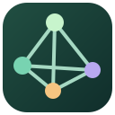

<div align="center">



# dsh-mesh-node

**Let Prism run a task on the device that has the project, using the same delegation controls as a local task.**

English | [简体中文](README.zh_CN.md)

</div>

## Set up Prism

Use Node.js 24.9 or later, npm, Git and credentials with read access to the five private plugin repositories. The checkout script places matching plugins and launcher files in a local `runtime/` directory. Run subsequent installation, configuration and launch commands there. The public guide is available without signing in. To use the example models, configure your DeepSeek credentials in DSH or set the `DEEPSEEK_API_KEY` environment variable. [Installation guide](https://prism.dsh-plug.in/)

```sh
git clone https://github.com/dsh-plugins/dsh-prism.git
cd dsh-prism
node scripts/checkout.mjs
cd runtime
npm ci
npm run build
npm start
```

## Connect a second device

1. Install Prism on both devices and give each its own `mesh.nodeId` and DSH data directory.
2. Generate an Ed25519 identity for each device. Register their public keys with a reachable WSS signaling server and give each device the other device's public key in `mesh.peers`.
3. On the worker, list the local project IDs the coordinator may access in that peer's `projects` field. Register the actual project directories, models and permissions on the worker.
4. Configure `mesh.webrtc` on both devices, including any STUN and TURN servers required by your network, then start both hosts.

Open the coordinator’s usual chat and ask about a shared project. Follow progress in the task card and open the worker’s DSH workspace to view the session history. Upgrading from HTTP Mesh requires replacing the URL, link token and `incoming` configuration on both devices. The technical reference includes the signaling and device configurations.

[Prism documentation](https://prism.dsh-plug.in/) · [Technical reference](docs/TECH.md)
